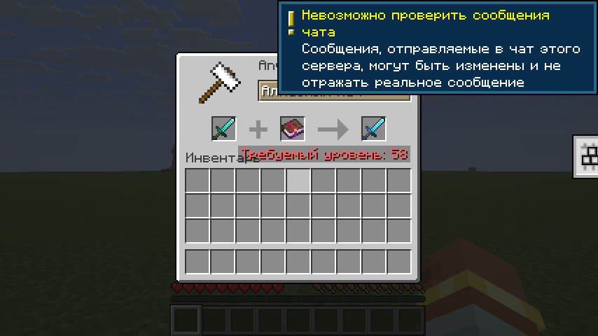

На MineHouse книгу с зачарованием Починка **нельзя** найти в сундуках по миру или купить у торговцев - её получает предмет, с которым долго работали на наковальне.

## Как это работает

- Книг Починки **нет** в сундуках, на рыбалке, у библиотекарей и в хранилищах испытаний.
- У каждого предмета есть штраф при повторном улучшении или восстановлении на наковальне. В обычной игре он удваивается после каждой работы (*0, 1, 3, 7, 15, 31...*). На сервере он растёт ровно на **10** уровней за каждую работу - 0, 10, 20, 30 и так далее.
- Работой считается починка, наложение книги и объединение двух предметов. Переименование предмета штраф не увеличивает.
- Когда штраф становится больше **80**, то есть примерно после 8 работ, предмет сам получает Починку прямо в результате наковальни.
- Лимита «Слишком дорого!» (*40 уровней*) **больше нет** - работа стоит столько, сколько и должна стоить в зависимости от количества работ с предметом и её всегда можно сделать.

**Починка не появится**, если она несовместима с чарами предмета, например на луке с Бесконечностью.

## Цена в окне наковальни

Обычный клиент Minecraft при цене от 40 уровней всё равно пишет «Слишком дорого!». Поэтому без мода такая цена показывается как 39, а настоящая пишется над хотбаром. Списывается всегда настоящая цена.

В [сборке MineHouse](/mods/) есть мод MineHouse Anvil Client: с ним настоящая цена видна прямо в окне наковальни.

