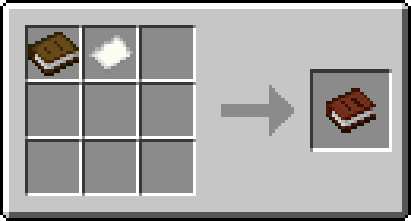
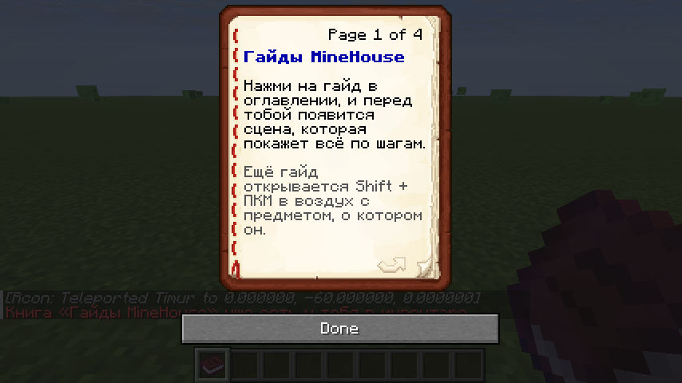

Для новых блоков и предметов сервера есть анимированные гайды: перед тобой появляется маленькая сцена, которая по шагам показывает, что делать. Её видишь только ты.

## Книга «Гайды MineHouse»

При первом входе на сервер ты получишь книгу «Гайды MineHouse». Открой её: в оглавлении нажми на нужный гайд, и сцена появится перед тобой. На последней странице подсказки, где смотреть рецепты.

Потерял книгу? Её можно скрафтить из книги и бумаги или получить командой `/guide book`.

## Другие способы открыть гайд

- **Shift + правый клик в воздух** с предметом, о котором есть гайд.
- Команда `/guide` показывает список гайдов, `/guide <название>` открывает гайд, `/guide close` закрывает.

В сцене есть кнопки «Сначала», «Дальше» и «Закрыть»: кликни по ним.

## Рецепты

В [сборке MineHouse](/mods/) есть JEI: наведи на предмет и нажми **R**, чтобы увидеть рецепт, или **U**, чтобы узнать, где предмет используется. Там же есть и рецепты предметов сервера.
