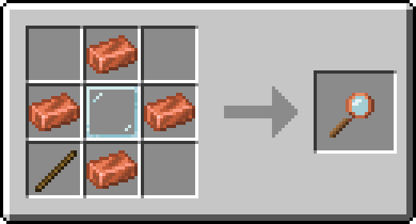

Лупа показывает **кто ставил и ломал блок или кто клал и брал предметы из сундука**. Это та же история, по которой админы откатывают гриф, только для всех игроков.

## Крафт

Для создания лупы вам понадобится **4 медных слитка, стеклянная панель и палка**, которые нужно расположить на верстаке в таком порядке как на изображении:

## Как пользоваться

- **Клик левой кнопкой мыши по блоку** показывает кто и когда ставил и ломал этот блок. Сам блок не сломается от лупы.
- **Клик правой кнопкой мыши по любому блоку-хранилищу** отобразит кто клал и забирал вещи. У двойного сундука показываются обе половины.
- **Клик правой кнопкой мыши по стороне блока** покажет историю пустого места перед ней. Так можно узнать кто сломал блок, которого уже нет.

Показываются последние 7 записей. Если кликнуть по тому же месту ещё раз в течение минуты, то лупа покажет следующие 7 записей.

Если обнаружил гриф **напиши администрации через тикеты** в Discord и они всё восстановят. **Сам ничего не ломай** в ответ.
