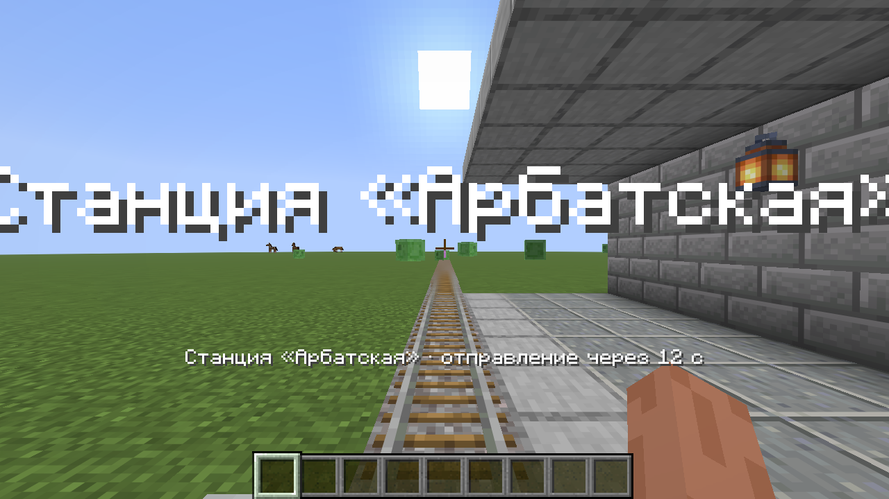
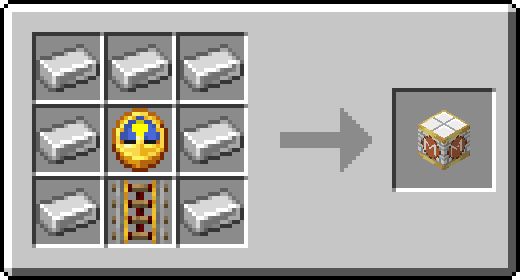
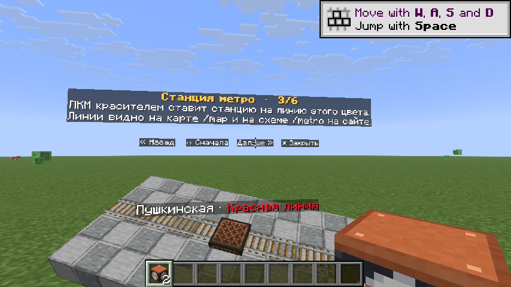
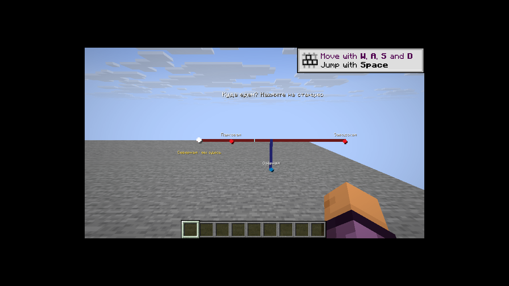
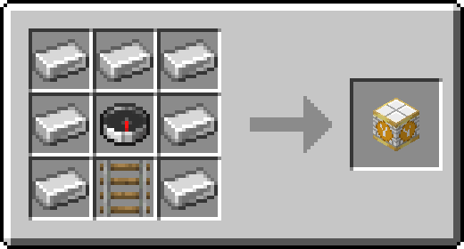
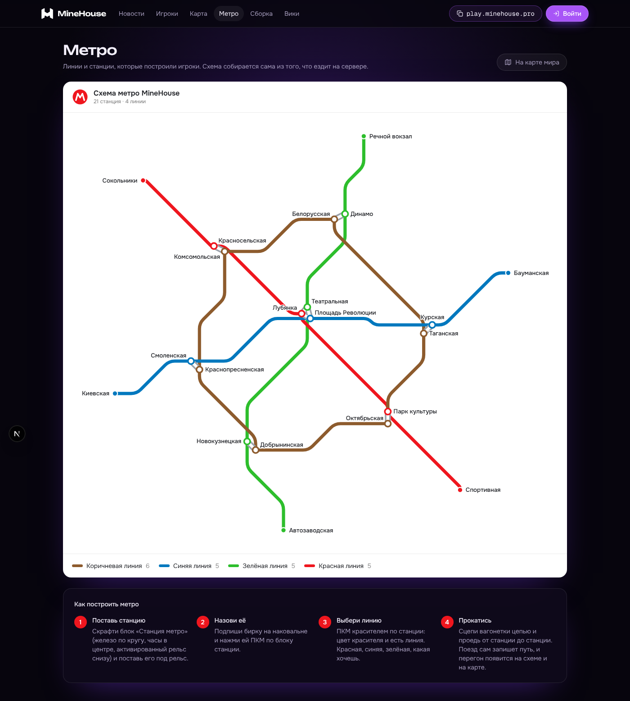

На сервере можно строить **своё метро**  поезда из вагонеток, станции с названиями, ветки со стрелками и схему линий на сайте. Всё работает на обычных рельсах.

## Быстрые вагонетки

Вагонетка с игроком на прямом ровном пути разгоняется до **80 блоков в секунду**, а каждый каждый энергорельс добавляет скорость. На поворотах и склонах она едет медленнее, как в обычной игре. Пустые вагонетки ездят с обычной скоростью.

Вагонетка с игроком **проезжает сквозь любые другие** вагонетки. Пустая обычная вагонетка на её пути ломается и выпадает предметом, а вагонетки с сундуком, воронкой, печью и динамитом просто пропускаются насквозь.

## Поезд

1. Поставь вагонетки на рельсы друг за другом.
2. Возьми цепь, зажми Shift и нажми правой кнопкой мыши по вагонетке, а потом по соседней.
3. Сцепленные вагонетки едут вместе как один поезд. В составе может быть до 12 вагонеток.

**Shift + клик правой кнопкой мыши** ножницами по вагонетке расцепляет её, а цепь выпадает.

Вагонетки поезда сами никуда не едут - толкни любой вагон и поедет весь состав. С конечной толкай назад и поезд поедет обратно.

## Станция

**Для создания** понадобится 7 железных слитков, часы и энергорельс:

- Поставь блок станции **под рельс** там, где поезд должен останавливаться. Подойдёт энергорельс с питанием или обычный рельс.
- **Название** - клик правой кнопкой мыши с переименованной биркой даст название твоей станции. Бирка при этом тратится.
- **Цвет линии Ж/Д** - клик правой кнопкой мыши красителем перекрасит станцию на линию этого цвета.
- Поезд **останавливается на станции**. С игроком он ждёт пока тот выберет на схеме куда ехать. Пустой поезд просто стоит.
- **Энергорельс** станции без питания **работает как депо** - поезд ждёт пока на рельс не дадут ток рычагом или редстоуном.

## Поездка по схеме

Сядь в вагонетку на станции и перед тобой **появится схема линий**. Нажми на нужную станцию и поезд поедет туда без остановок.

На схеме только пути, по которым уже проезжала вагонетка. **Сломанная станция пропадает со схемы**.

## Стрелка

**Для создания** понадобится 7 железных слитков, компас и рельс *(как станция, только компас вместо часов и рельс вместо энергорельса)*.

- Ставится **под обычный рельс** там, где от линии отходит ветка.
- Когда едешь по схеме **поезд сам переводит стрелку** за 4 блока до неё и сворачивает куда нужно.
- Поезда без маршрута едут так как лежит рельс. Стрелку, как обычную развилку, **можно переключить** редстоуном.
- **Новую ветку нужно один раз проехать** - так сервер узнаёт путь и он появляется на схеме.

## Схема на сайте

Станции и линии появляются на [карте мира](/mechanics/map/) и на странице [minehouse.pro/metro](https://minehouse.pro/metro) в виде схемы, как в настоящем метро.

Все шаги **можно посмотреть прямо в игре** в [книге гайдов](/mechanics/guides/) есть гайды «Станция метро», «Стрелка метро», «Поезд из вагонеток» и «Поездка по схеме».
