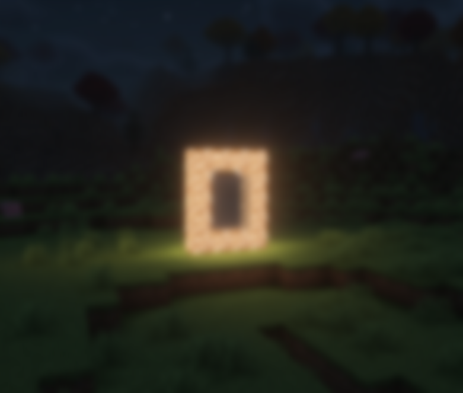
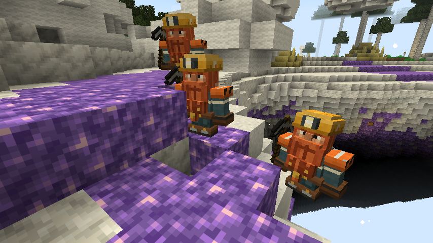
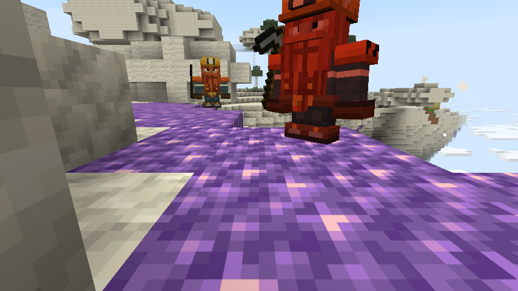
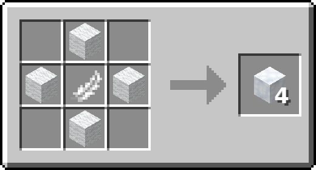
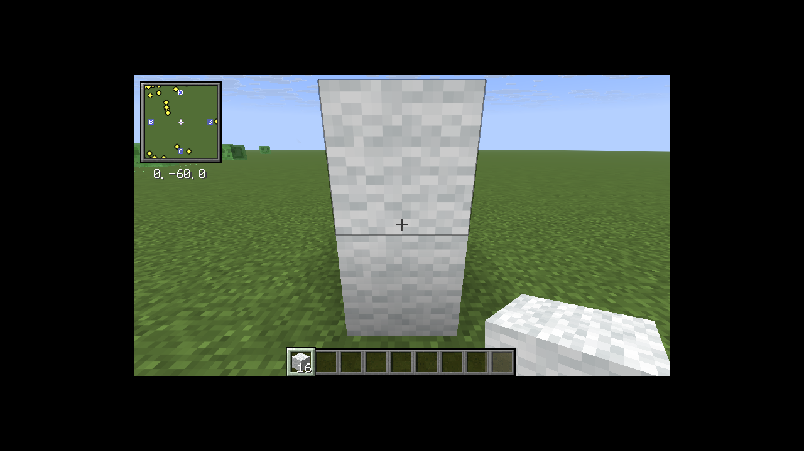

Рай это отдельное измерение: парящие острова из кальцита среди облаков, аметистовые шпили, высокие берёзовые рощи и пустота под ними.

## Как попасть

1. Построй вертикальную рамку из **светокамня**, как портал в Ад: внутри от 2×3 до 21×21 блоков.
2. Вылей внутрь **ведро воды**. Рамка заполнится порталом.
3. Зайди в портал. На мгновение закружится голова и потемнеет в глазах.

Портал работает только в Верхнем мире и в Раю и переносит на те же координаты (без деления на 8, как в Аду). Если рядом нет портала, на ближайшем острове появится новая рамка. После перехода портал 5 секунд тебя не трогает: чтобы вернуться, выйди из него и зайди снова.

## Что там есть

- **Биомы:** берега из белого песка по краям островов, аметистовые шпили, берёзовые рощи с огромными берёзами, трутовиками и ульями, травяные острова.
- **Облака** вокруг островов. По ним можно ходить.
- **Гейзеры:** столбы воды над серой, бьют вверх.
- **Алтари** из кварца на островах, разрушенные и целые. В сундуках целых алтарей бывает книга «Познание», см. [Новые зачарования](/mechanics/enchantments/).
- **Шахты дворфов** в толще островов, с рельсами и сундуками.
- **Магическая трава** растёт только здесь, см. [Магическая трава](/mechanics/magic-herb/).

## Дворфы

В шахтах живут дворфы: невысокие шахтёры с кирками. Они не трогают игроков, пока их не ударить, но если ударить, ответят киркой, и соседи придут на помощь. Иногда дворф стоит у скалы и стучит по ней киркой.

Над островами летают **дворфы-летуны** в алмазных касках и с деревянными крыльями. Иногда они сами прилетают к игрокам. С летуна может выпасть его потёртая алмазная каска, а если его победил игрок, иногда и книга «Амортизация».

## Падение

Если упасть с острова в пустоту, ты не умрёшь: тебя выбросит в небо Верхнего мира над теми же координатами. Перед самой землёй падение затормозит левитация, а потом плавное падение, так что приземлишься целым. Элитры при этом работают как обычно.

## Кровать

Спать в Раю нельзя: поставленная кровать растворяется.

## Облачко

Облачко это строительный блок, который можно ставить прямо в воздух.

**Крафт:** 4 белой шерсти крестом и перо в центре, получится 4 облачка.

|   |   |   |
| :-: | :-: | :-: |
|   | Белая шерсть |   |
| Белая шерсть | Перо | Белая шерсть |
|   | Белая шерсть |   |

- Правый клик облачком в пустоту ставит его в 3 блоках перед глазами. Если смотреть прямо вниз, оно встанет на 2 блока под ногами.
- Если смотришь на блок, облачко ставится как обычный блок.
- Ломается мгновенно и смягчает падение, как сноп сена.

