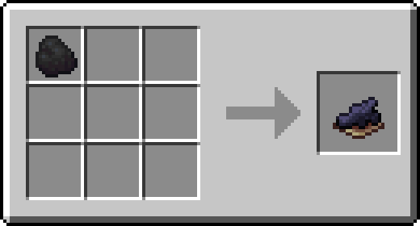

Небольшие изменения ванильной игры. Всё работает на сервере, клиенту ничего ставить не нужно.

## Рамки

- **Закрепить рамку:** правый клик сотой. Рамку больше не сломать случайно, предмет в ней не повернуть и не вытащить. Шифт + сота кладёт соту в рамку как обычный предмет.
- **Снять воск:** Шифт + правый клик топором.
- **Клик сквозь рамку:** правый клик по закреплённой рамке проходит в блок за ней. Удобно для подписей на сундуках: рамка висит на сундуке, а сундук открывается.
- **Невидимая рамка:** Шифт + правый клик ножницами по рамке с предметом. Видно только предмет, рамку нет. Тратит 1 прочности ножниц. Работает и со светящимися и закреплёнными рамками. Повторно ножницами рамка снова становится видимой, а если из невидимой рамки забрать предмет, она тоже станет видимой.

## Природа и мобы

- **Листва** опадает за несколько секунд после того, как срубили дерево.
- **Фантомов нет**, даже если долго не спать. Фантомные мембраны вместо них иногда падают с летучих мышей.
- **Цветущий аметист** можно добыть киркой с Шёлковым касанием и перенести в другое место.

## Крафт

- **Чёрный краситель** делается из угля или древесного угля, по одному на верстаке.

  

- **Грязь в котле:** брось землю в котёл с водой, и она станет грязью. Вода при этом не тратится.
- **Бетон в котле:** брось сухой бетон в котёл с водой, и он станет бетоном. Каждая начатая стопка из 64 штук забирает один уровень воды.

## Наковальня

- **Ремонт наковальни:** правый клик блоком железа по треснувшей или сломанной наковальне чинит её на одну ступень. Блок железа тратится.
- **Цветные названия:** при переименовании можно использовать цветовые коды `&`. Например, `&6Золотой меч` даст оранжевое название, `&l` жирный шрифт.

Про цену работ и Починку читай на странице [Наковальня и Починка](/mechanics/anvil/).

## Метка AFK

Если 5 минут ничего не делать, перед ником в табе и над головой появится серая метка `[AFK]`. Она пропадёт, как только ты снова начнёшь играть.

## Ники над головами

При первом входе сервер спросит, показывать ли тебе ники других игроков над их головами. Выбор можно поменять в любой момент:

| Команда | Что делает |
| --- | --- |
| `/nametags` | Переключить: показать или скрыть |
| `/nametags show` | Показывать ники |
| `/nametags hide` | Скрыть ники |
| `/nametags menu` | Открыть окно выбора ещё раз |

Это влияет только на то, что видишь ты. Другие игроки видят ники так, как выбрали сами.
