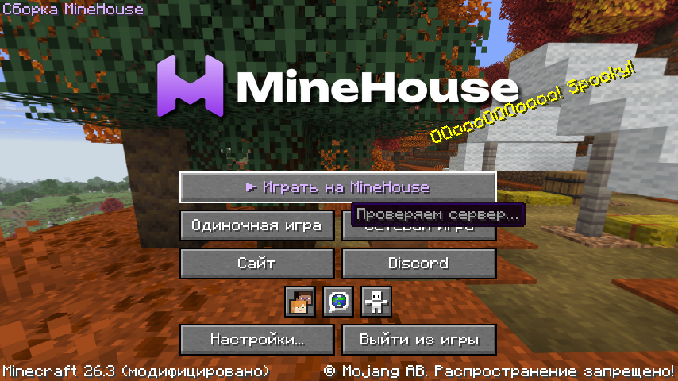
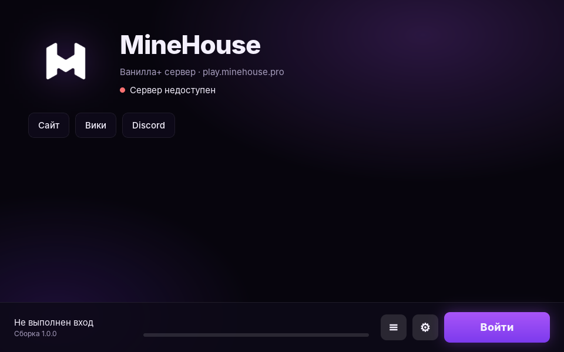

Зайти на сервер можно на чистой Minecraft Java 26.3, никакие моды не обязательны. Но с модами играть удобнее, и проще всего поставить нашу готовую сборку.

## Сборка MineHouse

На странице [minehouse.pro/modpack](https://minehouse.pro/modpack) лежит готовая сборка на Fabric: голосовой чат, пинги, эмоции, миникарта, рецепты, оптимизация и своё главное меню с кнопкой «Играть на MineHouse». Сборка сама обновляется: при запуске проверяет новые версии модов и подменяет их после выхода из игры.

Что внутри:

- **Plasmo Voice:** голосовой чат рядом с игроками.
- **Ping Wheel:** метки в мире для друзей.
- **Emotecraft:** эмоции, танцы и жесты, их видят другие игроки.
- **Xaero's Minimap:** миникарта и метки (пещерная карта и радар мобов выключены сервером).
- **JEI:** рецепты всех предметов, включая предметы сервера. **R** показывает рецепт, **U** где предмет используется.
- **AppleSkin:** сытость и насыщение еды.
- **Sodium, Iris, Lithium** и другие моды для FPS. Шейдеры по желанию, по умолчанию выключены.
- **Polymer:** блоки и предметы сервера ведут себя как настоящие, с верными названиями.
- **MineHouse Anvil Client:** настоящая цена в окне наковальни, см. [Наковальня и Починка](/mechanics/anvil/).
- Zoomify (зум на C), Mouse Tweaks, объёмные скины, головы игроков в чате и другие мелочи.

Исходники наших клиентских модов открыты: [P5ina/minehouse-mods](https://github.com/P5ina/minehouse-mods). Там же можно проверить, что jar в сборке собран ровно из них.

## Лаунчер MineHouse

У сервера есть свой лаунчер: он сам ставит игру и сборку и заходит на сервер одной кнопкой. Нужен аккаунт Microsoft с купленной Minecraft. Скачать: [GitHub](https://github.com/P5ina/minehouse-launcher/releases).

## Поставить моды по отдельности

Если не хочешь всю сборку, вот самое полезное:

| Мод | Зачем |
| --- | --- |
| [Plasmo Voice](https://modrinth.com/plugin/plasmo-voice) | Голосовой чат рядом с игроками |
| [Ping Wheel](https://modrinth.com/mod/ping-wheel) | Метки в мире для друзей |
| [Sodium](https://modrinth.com/mod/sodium) | Больше FPS |
| [Iris](https://modrinth.com/mod/iris) | Шейдеры |

Все они ставятся на **Fabric**. Проще всего через [Modrinth App](https://modrinth.com/app) или [Prism Launcher](https://prismlauncher.org/download/): создай профиль Fabric для 26.3 и добавь моды поиском.

## Что можно

Всё, что не даёт преимущества над другими игроками: оптимизация, шейдеры, интерфейс, миникарты без радара мобов и руд, просмотр рецептов.

## Что нельзя

X-ray (включая ресурспаки), киллауры, автокликеры, freecam, радары руд и игроков, любые чит-клиенты. За это бан, см. [Правила](/rules/).
